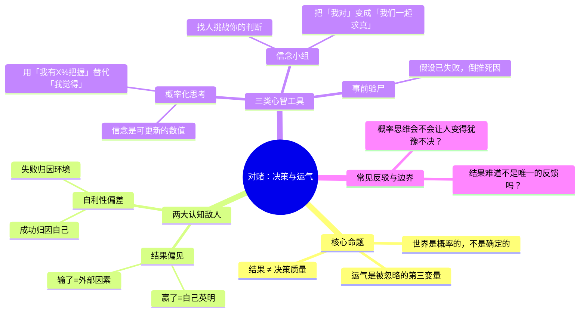

# 《对赌》读者笔记

> 读完第二遍，决定把之前零散的划线和想法收拢成一份完整笔记。这本书最有价值的地方不是教你怎么决策，而是逼你承认「你以为的决策好与坏，大部分时候只是运气好与坏」。

---

## 一、全书思想图谱

---

## 二、故事线：安妮·杜克的「扑克→决策」转变

这本书不是一本理论书，它的骨架是安妮自己的职业曲线：

1. **心理学博士中途辍学打德州扑克**——原本在宾大读认知心理学，偶然被朋友拉去打比赛，发现自己在概率计算和情绪控制上有天赋。
2. **职业牌手的核心冲击**：她很快发现，新手和高手最大的区别不是算牌，而是**复盘方式**。新手用每一局的输赢评判自己，高手用「这一把的决策在长期统计上是否为正期望」来评判。
3. **认知失调的关键案例**：她讲过自己一次经典的「坏决策赢钱」和「好决策输钱」——前者让她飘飘然，后者让她自我怀疑。正是这两种体验的反复出现，让她意识到「结果是被运气污染的反馈」。
4. **退役后做企业决策咨询**：把扑克桌上学到的东西，迁移到投资人、创业者、CEO身上，发现这些人犯的错和新手牌手一模一样——用结果反推决策。

> 读者感想：这条线最打动我的不是「她赢了多少比赛」，而是她作为一个认知心理学出身的人，**亲眼看到自己的大脑如何欺骗自己**。这不是别人的故事，是每个人每天都在犯的错。

---

## 三、核心观点拆解（含反向质疑）

### 观点1：结果偏见——不要用一次结果评判决策

**书里说什么**：
- 一个决策的好坏，要看「在当时的信息条件下，推理过程是否合理」，而不是看最后成没成。
- 就像扑克高手不会因为一把牌输了就否定自己的打法。

**反向观点 / 我的质疑**：
- 但是，**结果难道不是唯一可观测的反馈吗？** 你复盘的时候，除了结果，还有什么数据可用？
- 安妮的回答是：你需要积累大量样本，而不是用单次结果训练自己。一次好决策输钱，长期是正期望的；一次坏决策赢钱，长期是负期望的。
- **我的补充**：这在扑克桌上成立，因为一局牌重复次数足够多。但在人生重大决策（选行业、结婚、买房）上，你可能只有一次机会，这时候「长期统计」根本用不上。这个边界书里讲得不够。

### 观点2：自利性偏差——成功归自己，失败归运气

**书里说什么**：
- 人天生会美化自己：项目成了，是我方案好；项目黄了，是市场不好、队友拉胯、时机不对。
- 这种偏差让我们从经验中学不到东西——因为失败的时候永远在找外部原因。

**反向观点 / 我的质疑**：
- 完全「反求诸己」会不会走向另一个极端？有些失败确实是外部因素，比如行业整体衰退、政策突变。
- 安妮的解法不是「全怪自己」，而是**做归因拆分**：哪些是我可控的，哪些是我不可控的，分开打分。
- **我的补充**：这个拆分比书里写的更难。因为「哪些是可控的」本身就带有主观判断，人会下意识把不可控的因素算成可控的，或者反过来。

### 观点3：信念是概率，不是非黑即白

**书里说什么**：
- 不要说「我觉得这件事会成」，要说「我有60%的把握这件事会成」。
- 信念应该随着新证据的出现而更新，而不是一旦形成就捍卫到底。

**反向观点 / 我的质疑**：
- 很多时候你根本不知道概率是多少。一个新产品、一个新赛道，没有历史数据，你怎么算出60%还是70%？
- 安妮其实承认这一点：概率不是精确计算出来的，是**校准出来的**——你说60%的事情，长期来看真的有60%发生，这才叫校准。
- **我的补充**：对普通人来说，「概率化表达」最大的价值不是精确，而是**强迫你意识到自己可能是错的**。哪怕你只是把「肯定成」改成「大概率成」，心态就会不一样。

### 观点4：组建「信念小组」——找人和你对着干

**书里说什么**：
- 一个人思考容易陷入确认偏误，你需要几个敢于直接说「你错了」的朋友。
- 这个小组的目标不是赢得争论，而是一起逼近真相。

**反向观点 / 我的质疑**：
- 现实中大部分人找不到这样的人。朋友之间很难做到真正的坦诚，尤其是涉及面子的时候。
- 安妮的解法之一是「时间旅行」——假装这个观点是别人提出来的，你会不会一样支持？这是一个低成本的替代方案。
- **我的补充**：对独立工作者来说，写下来本身就是一种「时间旅行」。把你的判断写在纸上，过一周再看，你会自动发现很多当时没意识到的漏洞。

---

## 四、深度Q&A

### Q1：这本书和《思考，快与慢》是什么关系？重复吗？

不重复，角度完全不同。
- 《思考，快与慢》是**认知偏误的百科全书**，偏心理学理论，告诉你大脑有哪些系统偏差。
- 《对赌》是**一套可执行的决策方法论**，它的核心不是「人有偏见」，而是「既然人有偏见，那你具体该怎么训练自己」。
- 简单说：卡尼曼告诉你病是什么，安妮·杜克告诉你怎么练。

### Q2：如果我只能记住一句话，应该记住哪句？

**「好决策也会输，坏决策也会赢，但长期来看，好决策的人赢面更大。」**
这句话几乎涵盖了全书的核心——不要用单次结果评判自己，要看决策过程的质量。

### Q3：这本书适合什么人？不适合什么人？

适合：
- 经常做决策的人（产品、投资、创业、管理）
- 总在事后后悔「当初怎么没选另一条路」的人
- 想减少自我欺骗、提高复盘质量的人

不适合：
- 想要「三步学会做决策」速成技巧的人——这本书没有捷径
- 已经精通贝叶斯概率和决策论的人——对你来说太基础了
- 期待一本扑克小说的人——扑克只是案例，不是主线

### Q4：「事前验尸」具体怎么用？

举个我自己的例子：我之前想做一个个人技术博客，按书里的方法做了一次事前验尸——
1. 假设一年后这个博客彻底荒废了，为什么？
2. 倒推原因：写3篇之后就没东西可写了、没人看所以没动力、维护太花时间……
3. 对应措施：降低更新频率、不追求流量、用模板减少维护成本。

结果：现在还在更新，虽然慢，但没死。这个方法真的有用，因为它强迫你**在乐观的时候主动想最坏情况**。

### Q5：下注思考和「赌徒思维」的本质区别是什么？

这是最容易被误解的地方。
- **赌徒思维**：相信运气、相信直觉、相信「这把肯定能赢回来」，是情绪驱动的。
- **下注思考**：承认不确定性、计算概率、控制下行风险、长期期望为正才出手，是理性驱动的。
- 一句话：赌徒是被结果牵着走，下注思考是主动选择下注的位置和大小。

### Q6：书里有没有让你觉得「不对」或者「过头了」的地方？

有两个地方我保留意见：
1. **对「结果偏见」的批判有点矫枉过正**。有时候结果真的是最好的老师——比如你创业失败了，哪怕决策过程再完美，失败本身就是最有价值的反馈。不能因为「有运气成分」就否定结果的意义。
2. **「信念小组」的理想化程度太高**。现实中大部分人没有这种朋友，书里轻描淡写地说「找几个志同道合的人」，但怎么找、怎么维护这种坦诚关系，根本没讲。

---

## 五、读完之后，我打算做的三件事

1. **决策日志**：重要决策写下来，记录当时的信息、判断、预期概率，三个月后回头对照——看自己的「校准」准不准。
2. **复盘拆分**：以后项目复盘，强制分成「决策过程」和「运气因素」两栏，不混在一起打分。
3. **少说「肯定」**：日常表达里，把「肯定」「一定」换成「大概率」「我有七八成把握」，先从语言层面改变自己的思维习惯。

---

## 六、延伸思考：这本书和程序员的关系

我是写代码的，读完之后发现技术圈里的「结果偏见」特别严重：
- 某个技术选型踩坑了，就全盘否定那个技术，哪怕当时的选择在信息有限时是合理的。
- 某个项目成了，用的技术栈就被捧为「银弹」，忽略了项目成功可能只是因为需求刚好匹配。
- 复盘的时候，大家习惯说「这个方案好/不好」，而不是「这个方案在当时的条件下，期望收益是正的还是负的」。

如果团队能建立「决策质量」和「结果」分开评估的文化，复盘的质量会高很多——因为大家不再怕背锅，敢把真实的推理过程讲出来。

---

*笔记更新时间：2026-10-29*
#（注：内容由AI生成）
