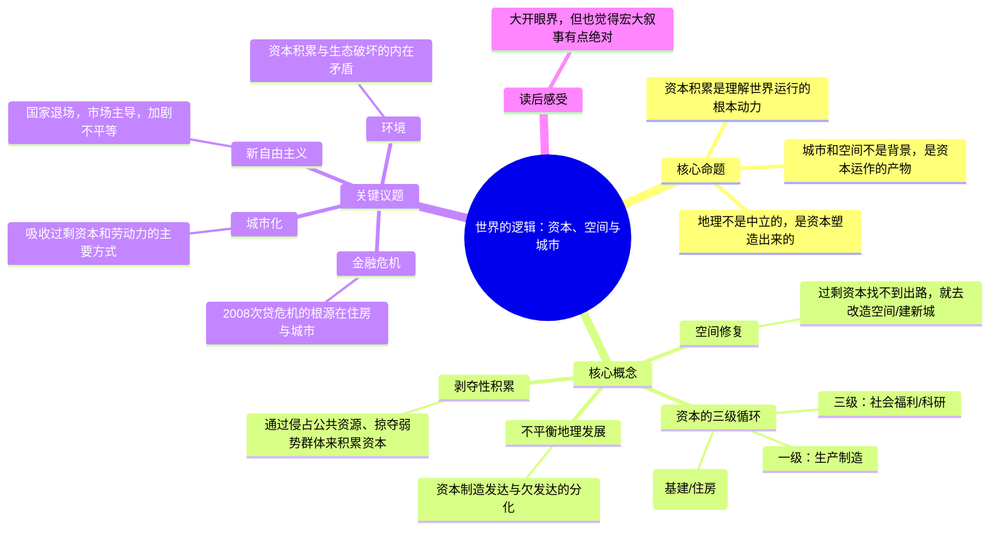

# 《世界的逻辑》读者笔记

> 读这本书之前，我以为它是一本「讲世界是怎么运转的」科普书。读完才发现，它是地理学家大卫·哈维用马克思主义的政治经济学框架，重新解释资本主义如何通过**空间**和**城市**来运转的论文集。不好读，但很颠覆。

---

## 一、全书思想图谱

---

## 二、故事线：从地理学家到马克思主义地理学家

这本书不是哈维从零写起的一本专著，而是他**几十年文章的一个精选合集**。读它需要先知道这个人是怎么走过来的：

1. **起点是传统地理学家**。哈维最早是搞地理学的，早年写过技术性的空间分析方法论，那时候他跟马克思主义没什么关系。
2. **转折点：1960-70年代的社会动荡**。越战、民权运动、全球性的城市危机，让他意识到传统地理学「只描述、不解释、更不批判」的做法已经解释不了现实。他转向马克思主义，试图用政治经济学去回答「城市为什么是这个样子」「资本为什么这样流动」。
3. **标志性研究：巴尔的摩的住房市场**。哈维长期在巴尔的摩调研，发现住房市场里的歧视、投机、置换（gentrification），背后全是资本逐利的逻辑，而不是单纯的市场价格波动。
4. **重读《资本论》**。他把马克思关于「资本循环」的论述，发展成一套关于「空间生产」的理论——资本不仅仅在工厂里剥削劳动，它还在改造城市、修建公路、炒作房地产、重塑整个地理。
5. **走向公共知识分子**。晚年他开始频繁对当下发声：2008年金融危机、新自由主义、中国的城市化、气候问题。这本书收录的，正是这一路思考的切片。

> 读者感想：这本书的故事线不是书里的人物故事，而是作者自己思想演变的轨迹。读的时候我一直在想——一个地理学家，最后变成了资本主义最尖锐的批判者，这条路本身就很能说明「地理学和政治有多近」。

---

## 三、核心观点拆解（含反向质疑）

### 观点1：城市是资本积累的产物，不是人自然聚居的结果

**书里说什么**：
- 城市不是人们「想住在一起」就长出来的，而是资本为了**吸收过剩的资本和劳动力**而不断生产出来的。
- 当资本生产过剩、找不到利润出口时，它就去建新城、搞基建、炒房地产——城市化成了过剩资本的「蓄水池」。
- 所以城市空间、住房价格、贫民窟的形成，都不是自然现象，背后是资本逐利的逻辑。

**反向观点 / 我的质疑**：
- 这个框架解释了很多现象，但**是不是把一切都归因于「资本」，有点过度归因了？** 城市的发展也有制度、文化、技术、甚至个人决策的因素，不是所有城市问题都能用「资本积累」一言蔽之。
- 哈维会用他的理论回应：这些因素最终都嵌套在资本积累的框架里。但这个回应有时显得像「怎么解释都对」的不可证伪。
- **我的感受**：它作为「解释的入口」很有力，但作为「唯一的解释」我会保留意见。

### 观点2：空间修复（Spatial Fix）——资本无处可去时，就去改造空间

**书里说什么**：
- 当过剩资本在国内找不到有利可图的出路时，它会向外扩张、改造空间——修路、建城、跨国投资、全球寻找廉价劳动力。
- 空间修复的本质是：资本通过「地理上的转移」暂时解决「积累过剩」的危机。
- 但这是个循环：修好一片地方，资本又转向别处，被抛下的地方就衰败。

**反向观点 / 我的质疑**：
- 这个理论对理解全球化、产业转移、中国基建很有解释力，但**它隐含了一个「资本是主角」的设定，把人、社区、地方当成了被资本摆布的棋子。** 现实中地方的能动性、反抗和自主选择被低估了。
- 不过哈维其实不否认反抗，他只是说资本积累的惯性极其强大，反抗常常被吸收、被市场化。
- **我的感受**：读完会感到一种无力感——好像所有努力最终都会被资本卷走。这种确定性既是力量，也是局限。

### 观点3：剥夺性积累——资本不只剥削，还会「抢」

**书里说什么**：
- 除了常规的剥削（压榨劳动），资本还有一条更野蛮的路：**剥夺性积累**。
- 把公共资源私有化、把公共土地圈走、利用债务掠夺穷人、把原本共享的东西变成可以买卖的商品。
- 新自由主义的核心，就是大规模地做这件事——公共服务市场化、公共住房出售、知识专利化。

**反向观点 / 我的质疑**：
- 这是整本书里最尖锐也最让我不适的观点。它的力量在于，确实戳中了很多人感受到的「社会越来越不公平」。
- 但我也在想：**私有化和市场化，是不是全都等同于「剥夺」？** 有些公共服务的市场化确实提高了效率、改善了供给，不能一概而论。
- **我的感受**：哈维的立场很鲜明，读它需要带着批判性，而不是全盘接受。它的价值在于给你一个看问题的角度，而不是给你一个绝对正确的答案。

### 观点4：金融危机不是偶然，是资本主义的内生规律

**书里说什么**：
- 2008年次贷危机的根源，不在几个贪婪的银行家，而在资本主义积累的**周期性危机**。
- 危机是资本主义「自我调节」的方式——通过一场大崩溃，把过剩的资本和债务清掉，重新为积累创造条件。
- 哈维从城市和住房的角度看：次贷危机的本质是「把住房金融化」，让普通家庭背上债务来维持资本积累。

**反向观点 / 我的质疑**：
- 这个「危机必然论」很有解释力，但**它在解释完之后，几乎没给出「怎么办」**。哈维批判得很到位，但建设性的出路很模糊。
- 这其实是左翼批判的通病：诊断很清晰，药方很含糊。
- **我的感受**：读这本书最好带着两个问题读：它诊断对了什么？它遗漏了什么？缺一个，都会读偏。

---

## 四、深度Q&A

### Q1：这本书到底属于什么学科？地理学？经济学？政治学？

它很难被归到单一一门学科。
- 作者是地理学家，但用的是马克思主义政治经济学的框架。
- 你可以说它是**批判地理学**、**政治经济学**、或者干脆是**跨学科的社会理论**。
- 它不是一本教你「怎么赚钱」或「怎么治国」的书，而是一本「解释世界为什么会是这样」的书。

### Q2：为什么这本书这么难读？

难读有几个原因：
1. **理论密度高**：每一篇都是压缩的政治经济学论述，不熟悉马克思概念（资本循环、剩余价值、积累）会跟不上。
2. **是文集，不是专著**：观点散在多篇文章里，没有一条从头到尾的线性主线，需要读者自己拼。
3. **写作对象是学界**：不是写给大众的通俗读物，默认你有一定理论背景。

如果读不下去，建议先从其中比较「接地气」的篇章（比如谈城市、谈危机的）入手，跳过最抽象的理论篇。

### Q3：这本书能帮我「预测未来」吗？

不能，也不该这么期待。
- 它的价值不是预测，而是**提供一套理解现实的框架**。
- 读了它，你能更清楚地看到：城市扩张、房价、产业转移、全球化背后的资本逻辑。
- 但它不会告诉你「明年房价涨还是跌」，它关心的是「房价涨跌背后的结构是什么」。

### Q4：作者立场太左，我能信吗？

带着批判读，但要读。
- 哈维确实是鲜明的马克思主义者，立场很左。如果你完全站在另一边，会经常觉得「太偏激」。
- 但即便你不同意他的全部结论，他的**提问方式和分析框架**仍有巨大价值——他逼你从「空间」和「资本」的角度看世界，这个角度主流经济学和新闻几乎不给你。
- 建议：把这本书当成「一种看世界的方式」，而不是「世界的唯一真相」。

### Q5：为什么这本书要讲城市？城市和「世界的逻辑」有什么关系？

因为哈维认为，**城市是资本主义最浓缩的载体**。
- 你每天看到的楼盘、地铁、写字楼、贫民窟、商业区，全是资本积累在空间上的投影。
- 金融危机、产业转移、人口流动、阶层分化，都会在城市的空间结构里显形。
- 理解了城市，就理解了资本主义的大部分运行方式。这是他为什么从巴尔的摩出发，最终走向整个世界的原因。

### Q6：读完这本书，我应该记住哪一句话？

**「资本积累永远需要一个出口，而空间和城市，就是它最惯用的出口。」**
这句话几乎是全书思想的浓缩——一旦你理解了资本需要出口，理解城市化、全球化、金融危机，就都有了抓手。

---

## 五、读完之后，我打算做的三件事

1. **用「空间」重新看日常**：下次路过一个楼盘、一条新修的地铁、一片被拆迁的老区，试着用哈维的框架想——这里的改造，是谁在受益？资本在做什么？
2. **补一点马克思的概念**：把书里频繁出现的资本循环、剩余价值、积累这几个概念，去找通俗解释看一遍，能大幅降低再读的难度。
3. **带着批判重读一遍**：第一遍我顺着它读，第二遍我要专门找它「过度归因」「没有药方」的地方，把它当作对话者，而不是老师。

---

## 六、延伸思考：一本让你重新「看见」身边空间的书

这本书最持久的影响，是它改变了我看待空间的方式。
以前我路过城市，只看到「这里繁华、那里破败」；读完之后，我开始看到「资本从哪里来、要流到哪里去、谁在受益、谁在承受代价」。
它未必会改变你的立场，但它几乎一定会改变你**观察的深度**——让你从一个「看风景的人」，变成一个「试图看懂风景背后逻辑的人」。对我来说，这就是它值得读的原因。

---

*笔记更新时间：2026-10-30*
